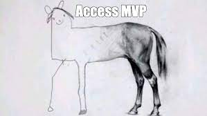
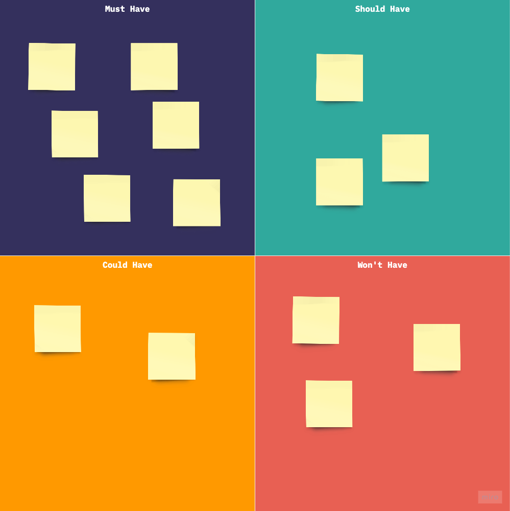
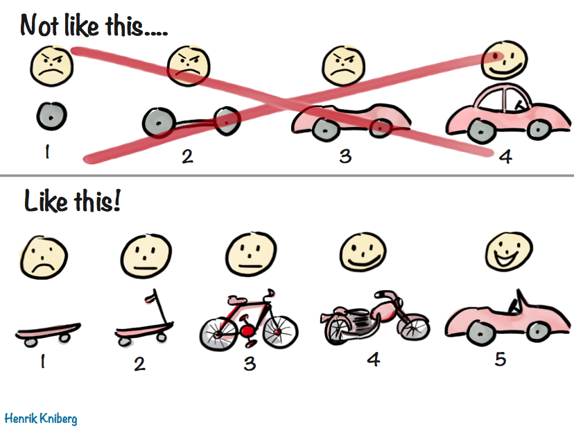
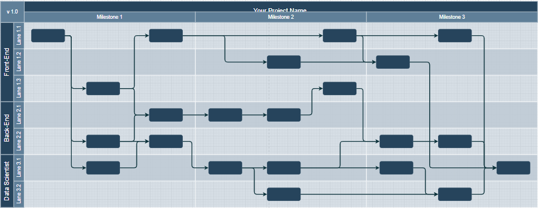
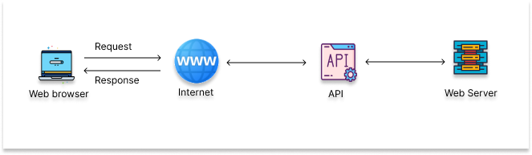
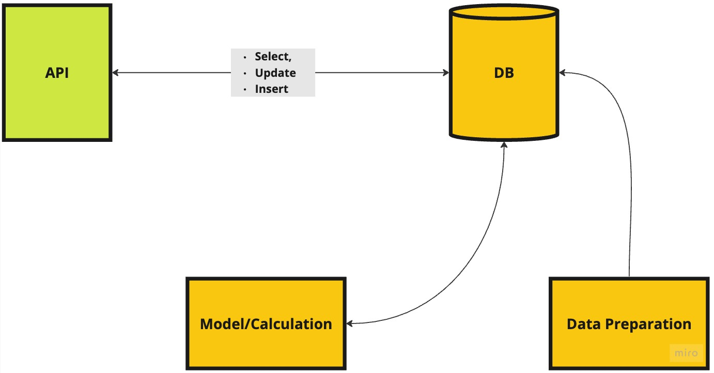
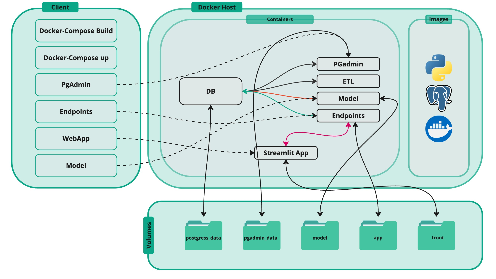

# How to Build a Data Product

We will start with the general process: define a useful product, choose its MVP, prioritize the work, and connect the components. The diagrams below support each step. Then we will apply the process to the **Bayesian Carousel Bandits** example.

## Product Mindset

### The Product-Building Cycle

```{mermaid}
flowchart LR
    accTitle: The product-building cycle
    accDescr: Define a user problem, choose a small MVP, build it, observe use, and improve it using feedback.
    P["Understand the<br/>user's problem"] --> M["Choose a<br/>small MVP"]
    M --> B["Build a<br/>usable version"]
    B --> T["Let users try it<br/>and measure results"]
    T --> I["Choose the<br/>next improvement"]
    I --> M
```

**Read the diagram from left to right.** Start with a decision the user needs to make, choose the smallest useful solution, and build something they can try. Observe what happens and use the results to choose the next version.

For the carousel example, the first useful flow is: **create a carousel → show alternatives → record a click → see the results**. Later versions can add richer analytics and more deployment options.

### Start with the User and the Problem

Before choosing tools or building a model, answer:

1. **Who is the user?** Identify who will use the result.
2. **What decision do they need to make?** Describe the problem in practical terms.
3. **How will the product help?** Define the action or insight it should provide.
4. **How will we measure success?** Choose a metric linked to the user's goal.

For example, a marketer needs to choose which offers to display in a carousel. The product uses click feedback to update its selection and reports metrics such as click-through rate and cumulative reward.

### Define an MVP

The **Minimum Viable Product (MVP)** is the smallest usable version that lets us try the core idea and learn from feedback.

- Choose one clear user flow.
- Include only the features needed to complete that flow.
- Make the result visible and easy to try.
- Use feedback and measured results to decide what to improve next.

Keep quality consistent across the core user flow so the complete experience is usable.

{width=100%}

### Prioritize with MoSCoW

Separate features into **Must have**, **Should have**, **Could have**, and **Won't have for now**. Keep the first version focused on the must-have features.

{width=100%}

### Sketch the User Flow

Describe what the user does from start to finish. Build a low-fidelity mockup to check that the inputs, actions, and results make sense before implementing the interface.

Tools such as [Stitch](https://stitch.withgoogle.com) and [Figma](https://www.figma.com) can help turn the idea into a mockup.

### Build a Usable Version, Then Improve It

Each iteration should let the user do something useful. Start with a working prototype and add complexity when it supports the product's purpose.

The lower sequence delivers a usable way to travel at every stage. Apply the same idea to a data product: each version should complete a useful user flow.

{width=100%}

Let someone try the MVP, observe where they struggle, and compare the results with the success metric. Use that feedback to choose the next improvement.

## Roadmap and Tasks

### Roadmap

Use a roadmap to describe how the product can grow:

1. Define the problem, user, and success metric.
2. Sketch the user flow and choose the MVP scope.
3. Prepare data and prototype the analytical logic.
4. Build an interactive prototype that demonstrates the core value.
5. Add persistent storage and connect the interface and backend.
6. Try the complete flow, collect feedback, and improve it.
7. Document setup, usage, and limitations.

A roadmap describes the intended sequence. Adjust it as you learn from the data, implementation, and user feedback.

Use the diagram below to discuss dependencies between frontend, backend, and analytical work. Each block represents a piece of functionality, and the arrows show what needs to be ready before the next piece can be completed.

{width=100%}

### Tasks

Break each step into small tasks with an observable result, such as creating a carousel, recording a click, or displaying a performance chart.

Track progress with a simple flow:

$$\text{Backlog} \rightarrow \text{In Progress} \rightarrow \text{Review} \rightarrow \text{Done}$$

- **Backlog:** describe the change and what successful completion looks like.
- **In Progress:** implement a focused change and record any blockers.
- **Review:** check the behavior against the task and the user's needs.
- **Done:** the change works and the relevant documentation is updated.

A task board such as **GitHub Projects** can help organize this work.

## Data Product Components

We will cover each component and practice connecting it to the rest of the application.

### Frontend, Backend, and Database

These are three parts of the application with different jobs. In the architecture we will build, they work together to turn a user's action into a useful result.

| Part | In simple terms | In our carousel product |
|---|---|---|
| **Frontend — Streamlit** | The interface people use: pages, buttons, forms, and charts. | A marketer creates a carousel and opens its analytics page. |
| **Backend — FastAPI** | The service that receives requests, applies the rules, and returns results. | It validates carousel settings, runs analytical logic, and prepares analytics results. |
| **Database — PostgreSQL** | Organized, lasting storage that the application can read and update. | It stores carousels, alternatives, clicks, and interaction history. |

### How They Connect

An **API** is an agreed way for one program to request something from another. For example, the frontend can ask the backend to return the results for a selected carousel.

```{mermaid}
flowchart LR
    accTitle: How the user, frontend, backend, and database connect
    accDescr: The browser interacts with Streamlit. Streamlit sends requests to FastAPI. FastAPI reads or writes PostgreSQL, and the results return along the same path.
    U["User<br/>Browser"] <-->|"actions / screens"| F["Frontend<br/>Streamlit"]
    F <-->|"API requests / results"| B["Backend<br/>FastAPI"]
    B <-->|"queries / records"| D[("Database<br/>PostgreSQL")]
    classDef frontend fill:#e7f1ff,stroke:#2563eb,color:#172554;
    classDef backend fill:#f0eaff,stroke:#7c3aed,color:#3b0764;
    classDef database fill:#e2f5eb,stroke:#15803d,color:#14532d;
    class F frontend;
    class B backend;
    class D database;
```

**Follow one action: opening the analytics page.**

1. **The user** selects a carousel in the browser.
2. **The frontend** asks the backend for that carousel's analytics through the API.
3. **The backend** asks the database for the relevant interactions and prepares the requested metrics.
4. **The database** returns the stored records to the backend.
5. **The backend** returns the results to the frontend.
6. **The frontend** displays the charts and tables to the user.

The arrows go both ways because each request has a response. When recording a click, the backend writes a new interaction to the database before returning a result. The browser reaches the stored data through these application services.

::: {.callout-note title="Where does Streamlit run?"}
The browser displays the interface, while Streamlit's Python code runs in a server process. In our design, that Python code calls the separate FastAPI service. We call Streamlit the **frontend service** because it provides the user interface. See [Streamlit's architecture](https://docs.streamlit.io/develop/concepts/architecture/architecture).
:::

### Where Does the Data Science Fit?

The analytical code turns data into a decision or an insight. For our carousel, it selects alternatives and updates beliefs using click feedback. We will develop this logic in Python and make it available through the backend. The frontend explains the result; the database keeps the history needed to produce it.

### Data Preparation and Processing

- Identify the data needed to solve the problem.
- Collect, generate, clean, and transform data as needed.
- Build a repeatable processing pipeline when the application requires it.

### Data Analysis and Modeling

- Explore the data and choose an appropriate analytical method.
- Build and evaluate the analytical logic or model.
- Define performance metrics and explain the results and limitations.
- Make model outputs available to the application and store results when needed.

### Database

Use **PostgreSQL** to manage the application's data:

- Design the data structure and tables.
- Store application settings, interactions, and analytical results.
- Create, read, update, and delete records from Python.

### Backend

Use **FastAPI** to expose the operations the product needs:

- Define endpoints around the user's actions and the business logic.
- Validate inputs and return structured responses.
- Connect the interface to the database and analytical logic.
- Explain and try endpoints through the API documentation.



### Frontend

Use **Streamlit** to build an interface where users can provide input, interact with the analytical logic, and explore results.

- **Quick prototyping:** turn Python scripts into interactive applications.
- **Interactive controls:** use sliders, forms, and buttons to explore different inputs.
- **Visualizations:** present results with charts and tables, using libraries such as Seaborn and Plotly where useful.
- **Integration:** connect the interface to the backend and display its responses.

### Version Control and Reproducible Environments

Use **Git** to track changes and develop features in small steps. Use **Docker** and **Docker Compose** to package services and run them together in a reproducible environment.

### Documentation

Use **MkDocs** to explain the product's purpose, setup, usage, architecture, and limitations so someone else can run and understand it.

## Microservices Architecture

A **service** is a running application that owns a responsibility and exposes a way to use it. A **microservices architecture** divides a product into independently deployable services organized around business capabilities, such as managing experiments or producing recommendations. Services agree on their inputs and outputs through APIs. [Microsoft's architecture guide](https://learn.microsoft.com/en-us/azure/architecture/guide/architecture-styles/microservices) describes these boundaries.

### Start with the Architecture We Are Building

Our first target is a **layered application deployed as several containers**: Streamlit presents the interface, FastAPI owns the product operations, and PostgreSQL stores the records. The bandit calculation can remain a Python module inside FastAPI.

```{mermaid}
flowchart LR
    accTitle: The first service boundaries for the carousel product
    accDescr: A browser uses the Streamlit service, which calls the FastAPI service. FastAPI contains the bandit logic and accesses PostgreSQL.
    U["Browser"] <-->|"screens and actions"| F["Frontend service<br/>Streamlit"]
    subgraph API["Backend service — FastAPI"]
        R["API routes"] --> L["Product rules<br/>and bandit logic"]
    end
    F <-->|"HTTP and JSON"| R
    L <-->|"SQLAlchemy and SQL"| D[("PostgreSQL")]
```

**Read each box as a responsibility.** Streamlit asks for an operation; FastAPI decides what it means and performs it; PostgreSQL keeps the resulting data. Changing the chart layout can stay within the frontend, while changing a database query belongs in the backend's data-access code.

The current Streamlit MVP still keeps its state locally and contains TODOs for API integration. This diagram is the design we are working toward, rather than a claim that every connection is already implemented.

### A Container and a Microservice Describe Different Things

| Term | What it describes | Example |
|---|---|---|
| **Component** | A part of the code or system. | A Python function that samples bandit alternatives. |
| **Service** | A separately running application with a defined responsibility. | The FastAPI application listening on port `8000`. |
| **Container** | The environment in which an application runs. | A container containing Python, FastAPI, and our backend code. |
| **Microservice** | A service with a focused business boundary that can be deployed independently. | A future recommendation service with its own API and data ownership. |

Putting the frontend, API, and database into three containers gives us a useful deployment structure. A larger microservices design also needs clear ownership, compatible API contracts, and independent release decisions.

### When Could We Split the Backend Further?

Suppose recommendation traffic grows while experiment management changes rarely. A possible future design is:

```{mermaid}
flowchart TB
    accTitle: A possible future microservices design with separate data ownership
    accDescr: A frontend calls an experiment service and a recommendation service through APIs. Each service owns its own data store, and the recommendation service requests experiment information through the experiment API.
    F["Frontend"] <-->|"create or inspect experiments"| E["Experiment service"]
    F <-->|"request a selection"| R["Recommendation service"]
    E <-->|"owns"| ED[("Experiment data")]
    R <-->|"owns"| RD[("Recommendation state")]
    R -->|"request experiment information by API"| E
```

**Follow the ownership arrows.** Each service controls its data and offers an API to other services. Another service asks for information through that API instead of depending directly on its internal tables. The stores could be separate databases on the same database server; the ownership boundary matters more than the number of machines.

This is a future design example. It does not require splitting the learning MVP into extra services. See [microservice data ownership](https://learn.microsoft.com/en-us/dotnet/architecture/microservices/architect-microservice-container-applications/data-sovereignty-per-microservice).

### Follow a Request Across the Boundaries

```{mermaid}
sequenceDiagram
    participant U as User
    participant F as Streamlit
    participant B as FastAPI
    participant D as PostgreSQL
    U->>F: Create a carousel
    F->>B: POST /carousels with JSON settings
    B->>B: Validate settings and prepare records
    B->>D: INSERT carousel and alternatives
    D-->>B: Saved records and identifiers
    B-->>F: HTTP response with JSON
    F-->>U: Show the created carousel
```

**Read this diagram from top to bottom.** Each arrow crosses a boundary. The API contract tells the frontend which fields to send and which response to expect. SQLAlchemy helps the backend turn Python objects into database operations.

### What Do We Gain, and What Must We Handle?

- **Separate changes:** update the interface while keeping the API contract stable.
- **Independent deployment:** replace a service without rebuilding every other service when their contracts remain compatible.
- **Focused scaling:** run more instances of a busy service when the deployment supports it.
- **Network failures:** a request can time out even when the calling service is healthy; define timeouts and useful error responses.
- **Data consistency:** an operation spanning services may need coordination. Retrying a request that creates something can create duplicates unless the API handles repeated requests deliberately.

For the MVP, use the smallest architecture that delivers the user flow. Add service boundaries when they make responsibilities and deployment easier to manage.

## What Is a Container?

A **container** runs an application in an isolated environment with the files and libraries it needs. For example, a backend container runs our FastAPI code with Python and the required packages. Containers share their host's operating-system kernel, which manages processes and hardware resources. [Docker's container guide](https://docs.docker.com/learn/content/what-is-a-container/) explains this model.

### Dockerfile → Image → Container

```{mermaid}
flowchart LR
    accTitle: From application code to a running container
    accDescr: Application code, dependency definitions, and a Dockerfile are used to build an image. Docker starts a container from that image.
    S["Code + dependencies<br/>+ Dockerfile"] -->|"build"| I["Image<br/>Prepared package"]
    I -->|"run"| C["Container<br/>Running application"]
    classDef package fill:#fff1dc,stroke:#c56a13,color:#713f12;
    class I,C package;
```

- **Dockerfile:** the build instructions, such as choosing Python, installing packages, and copying our code.
- **Image:** the prepared package used to create a container.
- **Container:** an instance of that image running with its own configuration.

**Read the arrows as actions:** we **build an image**, then **run a container** from it. This makes the application environment repeatable on compatible machines. See [Docker's explanation of images and containers](https://docs.docker.com/learn/content/what-is-a-container/#what-an-image-is).

## What Is a Docker Host?

The **Docker host** is the physical or virtual machine where Docker Engine runs and manages containers. **Docker Engine** is the software that creates, starts, and stops them. Your computer can provide this environment during development; a server can provide it when the product is deployed. See the [Docker Engine overview](https://docs.docker.com/engine/).

### The Same Product, Running in Containers

```{mermaid}
flowchart TB
    accTitle: Three application containers on one Docker host
    accDescr: A browser connects to the frontend container on a Docker host. The frontend calls the backend, the backend accesses the database, and database files are stored in a persistent volume. Docker Engine manages the containers.
    U["User's browser"]
    subgraph HOST["Docker host — the machine running Docker Engine"]
        direction TB
        E["Docker Engine<br/>Manages the containers"]
        subgraph NET["Application network — lets the services communicate"]
            direction LR
            F["Frontend container<br/>Streamlit"] <-->|"API"| B["Backend container<br/>FastAPI + analytical code"]
            B <-->|"read / write"| D[("Database container<br/>PostgreSQL")]
        end
        V[("Volume<br/>Saved database files")]
        E -.->|"manages"| F
        E -.->|"manages"| B
        E -.->|"manages"| D
        D <-->|"stores data"| V
    end
    U <-->|"published frontend port"| F
    classDef frontend fill:#e7f1ff,stroke:#2563eb,color:#172554;
    classDef backend fill:#f0eaff,stroke:#7c3aed,color:#3b0764;
    classDef database fill:#e2f5eb,stroke:#15803d,color:#14532d;
    classDef docker fill:#fff1dc,stroke:#c56a13,color:#713f12;
    class F frontend;
    class B backend;
    class D,V database;
    class E docker;
```

**Read the diagram from the outside in.** The outer box is the host. Inside it, Docker Engine manages three containers. The solid arrows show application communication; the dotted arrows show management by Docker Engine.

- **One container per service:** the interface, API, and database each have their own running environment.
- **A network connects them:** the frontend can reach the backend, and the backend can reach the database.
- **A published port lets the browser in:** for example, a local address such as `http://localhost:8501` can lead to the Streamlit container when that port is published.
- **A volume keeps database files:** the data can survive replacing the database container, as long as the volume is retained. See [Docker volumes](https://docs.docker.com/engine/storage/volumes/).

On macOS and Windows, Docker Desktop runs Linux containers in a managed Linux virtual environment. The Docker Engine and Linux containers live there, while you use Docker from your normal desktop. See [Docker Desktop networking](https://docs.docker.com/desktop/features/networking/).

### What Does Docker Compose Add?

**Docker Compose** describes the services, their connections, and their storage in one configuration file. It lets us start the product's containers together. Follow the [Docker tutorial](02_docker.qmd) to build this setup; the [official Compose overview](https://docs.docker.com/compose/intro/compose-application-model/) explains the same service, network, and volume concepts.

### Build Toward This Architecture

Start with a usable Streamlit MVP, develop the analytical logic, add persistent storage and API operations, then connect the services. Package the services as containers and run them together. At each step, check that the original user flow still works.

## Architecture Reference

### Data Flow

The components work together to move data through the application and make results available to the user.

{width=100%}

### Example Architecture

This architecture shows how the components can fit together as the application grows. An early MVP can start with fewer components; we will explore the full architecture through the tutorials.

{width=100%}

# Bayesian Carousel Bandits

The following case study applies the product development process to a Marketing Analytics application.


[Live App](https://carousel-mvp.streamlit.app)


## Product Summary

This **Bayesian Carousel Optimization** application is a guided example of building a **Marketing Analytics data product**.

The product simulates a real-world marketing problem where a team has multiple creative alternatives, offers, or content items (bandits), but can only show a limited number of them in a visible carousel area at a time.

Instead of randomly choosing which alternatives to display, the system uses **Bayesian learning** and **Thompson Sampling** to adaptively prioritize the alternatives that appear to perform better based on observed user clicks.

The MVP is implemented as a **multi-page Streamlit app** and is designed as the frontend prototype of a larger product that can later be integrated with a backend API, database, and deployment pipeline.


## Problem Definition

### Business Problem

**Marketing teams often need to choose among multiple alternatives such as:**

- promotional banners,
- campaign creatives,
- product cards,
- or recommendation tiles.

However, only a limited number of alternatives can be shown to users at once in a carousel or visible content area.

**The key challenge is:**

> **How can we decide which alternatives to show in each round so that we learn from user behavior and gradually improve click performance over time?**

A static rule-based system or random selection is inefficient because:

- it may keep showing underperforming alternatives,
- it does not learn from feedback,
- and it does not balance experimentation with optimization.


### Specific Problem Statement

**We want to build a product that:**

- creates carousel projects with a configurable number of total alternatives,
- chooses only a subset of alternatives to display in the visible area,
- collects interaction feedback in the form of clicks / no-clicks,
- updates beliefs about each alternative after every round,
- and visualizes which alternatives are performing best over time.

This is modeled as a **multi-armed bandit problem** with:

- **Bernoulli rewards**
- **Beta priors/posteriors**
- **Thompson Sampling** for selection


## Proposed Solution

### Core Idea

Each alternative in a carousel is treated as a **bandit arm**.

**For every alternative, the system keeps:**

- a prior belief about its click-through rate,
- updates that belief after each user interaction,
- and samples from the posterior to decide which alternatives should be displayed next.

The visible area might show, for example:

>**4 visible alternatives** out of **10 total alternatives**


**At every round:**

1. the system samples a score for each alternative from its Beta posterior,
2. selects the top alternatives according to Thompson Sampling,
3. displays them in the carousel,
4. observes a user click or no-click outcome,
5. updates the posteriors,
6. and repeats the process.

**This allows the system to balance:**

- **exploration** of uncertain alternatives,
- **exploitation** of alternatives that already look strong.


## Current MVP


### What We Have Built

The current MVP is a **Streamlit application with 3 pages**: 

#### Page 1 | Create Carousels

**This page allows the user ([Page 1 URL](https://carousel-mvp.streamlit.app)):**

- create a new carousel project,
- define the total number of alternatives,
- define the visible area size,
- list all available carousel projects,
- inspect the alternatives of a selected carousel,
- reset a selected carousel.


#### Page 2 | Interaction

**This page is where the live bandit interaction happens ([Page 2 URL](https://carousel-mvp.streamlit.app/Interaction)).**

**The user can:**

- choose a carousel,
- see the currently selected visible alternatives,
- click one of the displayed alternatives,
- move to the next round with no click,
- or resample without updating.

**For every round, the app updates:**

- impressions,
- clicks,
- alpha / beta values,
- posterior mean,
- and empirical CTR.


#### Page 3 | Analytics

**This page summarizes performance for each carousel project ([Page 3 URL](https://carousel-mvp.streamlit.app/Analytics)).**

**It currently includes:**

- overall carousel project listing,
- total impressions,
- total clicks,
- average reward,
- champion bandit identification,
- posterior mean comparison,
- click comparison,
- Beta posterior distribution visualization,
- detailed results table,
- cumulative reward over time.


## Methodology

### Reward Structure

We use a **Bernoulli reward**:

- `1` = user clicked one of the displayed alternatives
- `0` = no click for a displayed alternative

### Bayesian Model

For each alternative, we model click probability using a **Beta-Bernoulli setup**:

- **Prior:** `Beta(alpha, beta)`
- **Outcome:** Bernoulli click / no-click
- **Posterior update:**
  - clicked alternative: `alpha += 1`
  - displayed but unclicked alternatives: `beta += 1`

### Selection Strategy

We use **Thompson Sampling**:

- draw one sample from each alternative’s posterior,
- rank alternatives by the sampled values,
- display the top `k` alternatives where `k = visible_count`.

---

### The Value

This product is a strong fit for Marketing Analytics because it demonstrates:

- experimentation under uncertainty,
- user behavior learning,
- adaptive optimization,
- measurable reward improvement,
- and a clear connection between analytics and product decision-making.

>Instead of simply reporting past A/B test results, the system actively decides what to show next based on observed performance.


## Architecture

**The final product can evolve into:**

- **Frontend:** Streamlit
- **Backend:** FastAPI
- **Database:** PostgreSQL
- **Analytics service:** Python-based bandit engine
- **Deployment:** Docker / containerized services


## Steps to Achieve the Full Product

### Step 1 | Finalize the MVP logic

- validate carousel creation flow,
- validate selection and update rules,
- confirm reward assumptions,
- confirm analytics outputs.

### Step 2 | Separate frontend from logic

- move bandit logic from Streamlit session state into reusable backend functions,
- define clear API contracts,
- keep Streamlit as the UI layer only,
- learn basic requests with `FastAPI`

### Step 3 | Build backend endpoints

**Planned API functionality:**

- create carousel,
- list carousels,
- fetch selected visible alternatives,
- submit click / no-click feedback,
- get analytics for a carousel,
- reset or delete a carousel.

### Step 4 | Add database persistence

**Create PostgreSQL tables for:**

- carousel projects,
- alternatives,
- interaction history,
- posterior parameters,
- analytics summaries.

### Step 5 | Connect frontend to backend

**Update the Streamlit pages so they:**

- fetch data from API,
- submit interaction events,
- display live analytics from the database.

### Step 6 | Improve analytics

**Extend the analytics layer with:**

- richer reward history,
- posterior distribution comparison,
- best-bandit explanation,
- possible regret or lift analysis.

### Step 7 | Polish product UX

- improve visual hierarchy,
- improve labeling and explanations,
- add screenshots and deployment URL,
- add project documentation.

### Step 8 | Containerize and deploy

- add Docker support,
- configure environment variables,
- deploy the frontend,
- connect deployed frontend to backend and DB.
